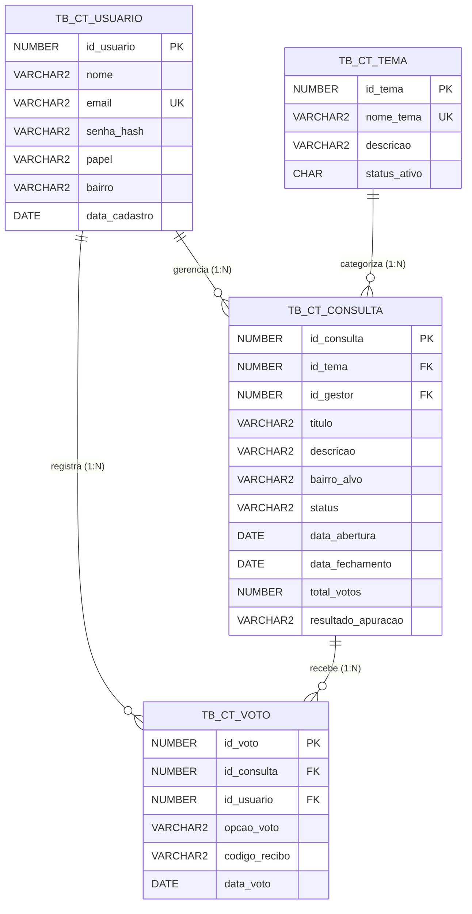

# Cidade Tech — Mastering Relational and Non-Relational Database

Entrega oficial da disciplina **Mastering Relational and Non-Relational Database** para a **Global Solution 2026/2 (FIAP)**.

---

## 👥 Integrantes do Grupo (Turma: 2TDSPB)

* **Eric Maciel** — RM 567398
* **Gabriel Correa Souza** — RM 567903
* **Kayque Duarte** — RM 567980

---

## 🏙️ Contexto da Solução: Cidade Tech

* **Tema Global Solution**: CitizenTech (Tecnologia com o cidadão no centro).
* **Eixo Temático**: **Serviços e Direitos** → **08. Participação Cidadã: consultas, propostas, decisões comunitárias e acompanhamento de resultados**.
* **Proposta**: O **Cidade Tech** é uma plataforma focada em democratizar o acesso às decisões locais de bairros e municípios. Gestores de associações de moradores ou conselhos municipais cadastram consultas e propostas de melhoria (mobilidade, iluminação, saúde, praças, etc.), moradores autenticados votam (a favor, contra ou abstenção) e a comunidade tem acesso transparente ao resultado consolidado após o encerramento da votação.

---

## 🗄️ Modelo Relacional de Dados (Oracle Database)

O modelo foi projetado com 4 tabelas centrais com integridade referencial rigorosa:



### Regras de Integridade e Constraints
1. **`UK_CT_VOTO_UNICO` em `TB_CT_VOTO`**: `UNIQUE(id_consulta, id_usuario)`. Garante que cada cidadão possa votar no máximo uma vez em cada consulta.
2. **`CK_CT_USUARIO_PAPEL`**: Garante que o papel do usuário seja apenas `CIDADAO` ou `GESTOR`.
3. **`CK_CT_CONSULTA_STATUS`**: Estados do ciclo de vida: `RASCUNHO`, `ABERTA` ou `ENCERRADA`.
4. **`CK_CT_VOTO_OPCAO`**: Restringe o voto para `FAVOR`, `CONTRA` ou `ABSTENCAO`.

---

## 📂 Organização dos Scripts SQL

| Arquivo | Descrição | Requisito Atendido |
| :--- | :--- | :--- |
| **`01_ddl_tables.sql`** | Criação das 4 tabelas, chaves primárias, estrangeiras e constraints de integridade | *Requisito 01 - Modelo Oracle* |
| **`02_dml_inserts.sql`** | Carga inicial com mais de 10 registros por tabela com dados consistentes do projeto | *Requisito 01 - Dados de Teste* |
| **`03_plsql_anonymous_block.sql`** | Bloco anônimo PL/SQL com `SELECT INTO`, `DBMS_OUTPUT` e decisão `IF/ELSIF/ELSE` | *Requisitos 02 e 03* |
| **`04_plsql_cursor_loop.sql`** | Cursor explícito com estrutura de repetição (`LOOP`, `FETCH`, `%NOTFOUND`) | *Requisitos 04 e 05* |
| **`05_plsql_stored_procedures.sql`** | Criação das duas Stored Procedures (`PRC_REGISTRAR_VOTO` e `PRC_APURAR_CONSULTA`) | *Requisito 06 - 2 Procedures* |
| **`06_exec_tests_evidence.sql`** | Script unificado de execução e bateria de testes para coleta de evidências | *Evidências de Execução* |

---

## ⚙️ Regras de Negócio e Componentes PL/SQL

### 1. Bloco Anônimo com Decisão `IF / ELSIF / ELSE` (`03_plsql_anonymous_block.sql`)
* Recupera uma consulta específica com dados do tema, gestor e contagem agregada de votos via `SELECT INTO`.
* Aplica a lógica condicional para emitir a recomendação do Cidade Tech à prefeitura/associação:
  * **0 votos**: `SEM PARTICIPAÇÃO POPULAR SUFICIENTE`.
  * **Favor >= 70%**: `APROVADA COM AMPLA ADESÃO POPULAR` (Prioridade máxima de inclusão orçamentária).
  * **Favor >= 50%**: `APROVADA POR MAIORIA SIMPLES` (Apto para viabilidade técnica).
  * **Contra > Favor**: `REJEITADA PELA COMUNIDADE` (Revisão ou arquivamento).
  * **Demais casos**: `DIVISÃO DE OPINIÕES / EMPATE TÉCNICO`.

### 2. Cursor Explícito com Loop (`04_plsql_cursor_loop.sql`)
* Abre explicitamente o cursor `cur_consultas`, percorrendo todas as consultas com `FETCH` até `cur_consultas%NOTFOUND`.
* Realiza a sumarização em tempo real de votos por status (`ABERTA`, `ENCERRADA`, `RASCUNHO`) e exibe o relatório gerencial completo formatado em colunas.

### 3. Procedimento Armazenado de Operação: `PRC_REGISTRAR_VOTO`
* **Tipo**: Operação transacional (DML).
* **Parâmetros**: `(p_id_consulta, p_id_usuario, p_opcao_voto, OUT p_codigo_recibo)`.
* **Regras Verificadas**:
  1. Opção válida (`FAVOR`, `CONTRA`, `ABSTENCAO`).
  2. Validação se a consulta existe e se o status é **`ABERTA`** (votos são rejeitados em consultas em `RASCUNHO` ou já `ENCERRADA`).
  3. Validação de usuário existente.
  4. Validação de **voto único**: impede duplicidade com erro customizado `-20005`.
  5. Geração de recibo de auditoria único (`REC-C...-U...-TIMESTAMP`).
  6. Incremento atômico de `total_votos` na tabela `TB_CT_CONSULTA`.

### 4. Procedimento Armazenado de Consulta e Processamento: `PRC_APURAR_CONSULTA`
* **Tipo**: Processamento / Apuração oficial.
* **Parâmetros**: `(p_id_consulta, OUT p_resultado_final, OUT p_total_apurado)`.
* **Regras e Ações**:
  1. Totaliza os votos computados por opção.
  2. Calcula percentuais oficiais de aprovação e rejeição.
  3. Atualiza o status da consulta para `ENCERRADA`, preenche a `data_fechamento` e grava o veredito final (`APROVADA`, `REJEITADA` ou `INCONCLUSIVA`).
  4. Emite a **Ata Oficial de Apuração** no console via `DBMS_OUTPUT`.

---

## 🚀 Como Executar no Oracle Database

Você pode executar os scripts no **Oracle SQL Developer**, **SQL*Plus**, **DBeaver** ou no **Oracle Live SQL**:

1. **Habilite a saída do console**:
   ```sql
   SET SERVEROUTPUT ON SIZE UNLIMITED;
   ```
2. **Execute na ordem sequencial**:
   ```sql
   @01_ddl_tables.sql
   @02_dml_inserts.sql
   @03_plsql_anonymous_block.sql
   @04_plsql_cursor_loop.sql
   @05_plsql_stored_procedures.sql
   @06_exec_tests_evidence.sql
   ```
3. **Ou execute diretamente o `06_exec_tests_evidence.sql`** após carregar as tabelas e procedures para rodar todos os cenários de teste e coletar os prints de tela para a entrega!
